# Carnes del Sur — Tienda en línea (ASP.NET Core MVC)

Aplicación web de comercio electrónico para una carnicería, desarrollada como **proyecto académico** de Ingeniería de Sistemas en la Universidad Americana (UAM), Costa Rica, 2025. Incluye catálogo con búsqueda y filtros, carrito de compras, pedidos, pagos de prueba con PayPal (sandbox), correo transaccional y un panel de administración con reportes.


> **Alcance:** prototipo académico que se ejecuta en local. No está en producción, y los pagos usan exclusivamente el entorno *sandbox* de PayPal.

## Contenido
- [Capturas](#-capturas)
- [Funcionalidades](#-funcionalidades)
- [Tecnologías](#️-tecnologías)
- [Arquitectura](#️-arquitectura)
- [Flujos principales](#-flujos-principales)
- [Modelo de datos](#-modelo-de-datos)
- [Cómo ejecutarlo en local](#-cómo-ejecutarlo-en-local)
- [Seguridad aplicada](#-seguridad-aplicada)
- [Limitaciones conocidas y próximos pasos](#️-limitaciones-conocidas-y-próximos-pasos)
- [Documentación del proyecto](#-documentación-del-proyecto)
- [Autoría](#-autoría)

---

## Capturas

<!--
| Tienda | Carrito | Panel de administración |
|---|---|---|
| 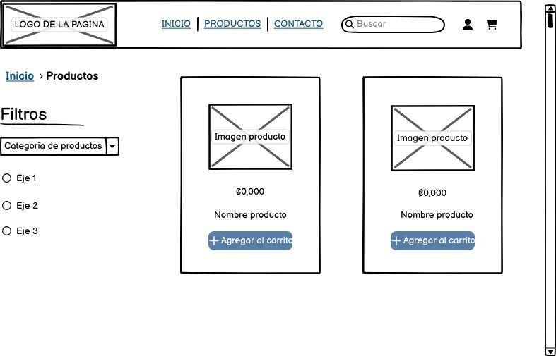 | 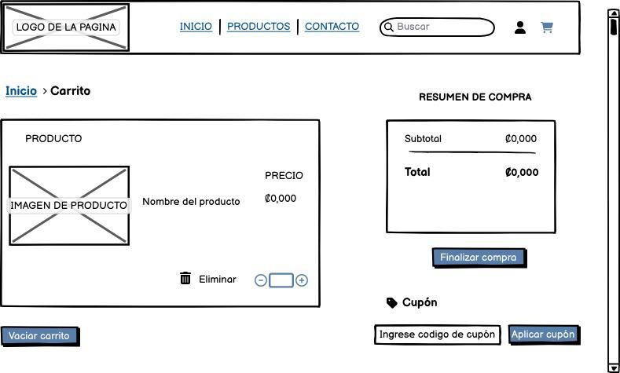 | 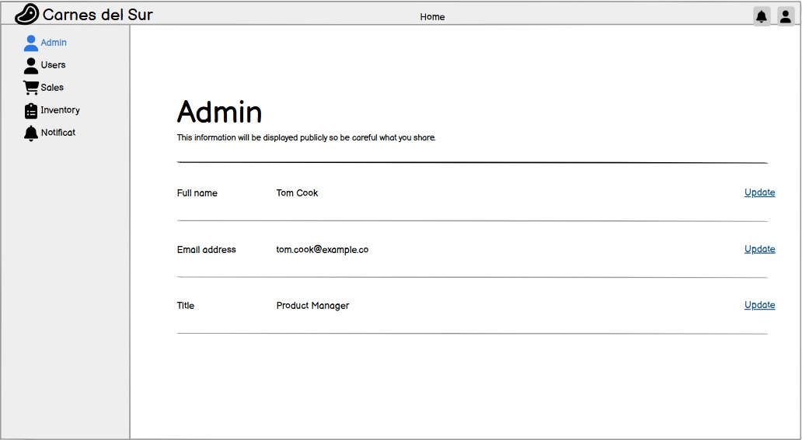 |
-->

Los diseños de interfaz iniciales (mockups) están en [Documentación del proyecto](#-documentación-del-proyecto).

---

## Funcionalidades

### Visitantes
- **Inicio** con los 4 productos más recientes.
- **Tienda** con búsqueda por nombre, filtros por **marca** y **categoría**, orden por novedad o precio, y paginación de 8 productos por página.
- **Detalle de producto** y página de **contacto** con mapa.
- **Carrito de compras** guardado en una cookie, con contador en la barra de navegación.

### Clientes (rol `cliente`)
- **Registro, inicio de sesión y cierre de sesión** con ASP.NET Core Identity. Las cuentas nuevas reciben el rol `cliente` automáticamente.
- **Recuperación de contraseña** mediante un enlace con token, enviado por correo con Brevo.
- **Perfil editable** (nombre, apellido, correo, teléfono, dirección) y **cambio de contraseña**.
- **Checkout** con entrega a domicilio o **retiro en el local** (sin costo de envío), cálculo de **IVA del 13 %** y tres métodos de pago:
  - Pago contra entrega
  - PayPal (sandbox): creación y captura de la orden mediante la API REST v2
  - Tarjeta de crédito (a través del flujo de PayPal)
- **Mis pedidos**: historial paginado con detalle. Cada cliente ve solo sus propios pedidos.

### Administradores (rol `admin`)
- **Productos**: CRUD completo con carga de imagen, búsqueda por nombre o marca, orden por columna y paginación.
- **Pedidos**: listado, detalle (cliente, artículos y cantidad de pedidos del cliente) y actualización del **estado de pago** y del **estado del pedido**.
- **Usuarios**: listado, detalle, **cambio de rol** y **eliminación de cuentas**, con protección para que un admin no pueda cambiar su propio rol ni eliminarse a sí mismo.
- **Reportes con Chart.js**:
  - Top 10 de productos más vendidos
  - Ventas por mes (₡)

---

## Tecnologías

| Capa | Tecnología |
|---|---|
| Backend | C#, ASP.NET Core MVC (.NET 7) |
| Datos | Entity Framework Core 7 (code-first, migraciones), SQL Server |
| Autenticación y autorización | ASP.NET Core Identity, autorización por roles |
| Frontend | Razor, HTML, CSS, JavaScript, Bootstrap, Bootstrap Icons, Font Awesome |
| Gráficos | Chart.js |
| Integraciones | PayPal REST API v2 (sandbox), Brevo (`sib_api_v3_sdk`) para correo transaccional |
| Diseño y documentación | draw.io (diagramas), mockups de baja fidelidad, Excel (diccionario de datos y casos de uso) |

---

## Arquitectura

### Diseño planificado
El diagrama de componentes del proyecto propone **cuatro capas**:

```mermaid
flowchart LR
    subgraph P["Capa de presentación"]
        P1[Usuarios]:::m
        P2[Administrador]:::m
        P3[Productos]:::m
        P4[Contacto]:::m
    end
    subgraph L["Lógica de negocio"]
        L1[Gestión de usuarios]:::m
        L2[Gestión de productos]:::m
        L3[Gestión de pedidos]:::m
        L4[Gestión de contacto]:::m
    end
    subgraph D["Acceso a datos"]
        D1[Repositorio de usuarios]:::m
        D2[Repositorio de productos]:::m
        D3[Repositorio de pedidos]:::m
        D4[Repositorio de contacto]:::m
    end
    subgraph B["Base de datos"]
        B1[Entidades]:::m
        B2[Diccionario]:::m
    end
    P <--> L
    L <--> D
    D <--> B
    classDef m fill:#f6f6f6,stroke:#888
```

### Implementación actual
La versión entregada simplifica ese diseño a un **MVC de un solo proyecto**:

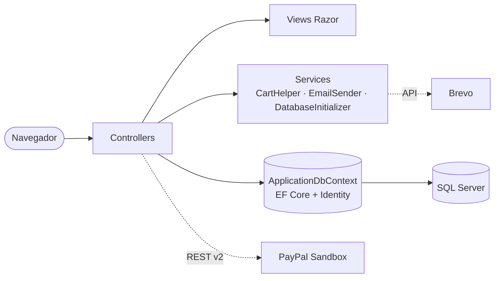

Los controladores acceden directamente al `DbContext`; las capas de repositorio y servicios de dominio del diseño original quedaron como mejora pendiente (ver *Limitaciones*).

### Rutas principales

| Área | Ruta | Acceso |
|---|---|---|
| Tienda (página por defecto) | `/` · `/Tienda` · `/Tienda/Details/{id}` | Público |
| Inicio y contacto | `/Home` · `/Contacto` | Público |
| Carrito y checkout | `/Carrito` · `/Carrito/Confirm` · `/Checkout` | Público / autenticado al confirmar |
| Cuenta | `/Cuenta/Login` · `/Cuenta/Register` · `/Cuenta/Profile` · `/Cuenta/Password` · `/Cuenta/ForgotPassword` | Público / autenticado |
| Mis pedidos | `/Cliente/Ordenes` | `cliente` |
| Administración | `/Admin/Productos` · `/Admin/Ordenes` · `/Admin/Usuarios` | `admin` |
| Reportes | `/Admin/Ordenes/ProductosMasVendidos` · `/Admin/Ordenes/VentasPorMes` | `admin` |

### Estructura de carpetas

```
CarnesDelSurMVC/
├── Controllers/
│   ├── HomeController.cs            # Inicio (productos recientes)
│   ├── TiendaController.cs          # Catálogo, filtros, detalle
│   ├── CarritoController.cs         # Carrito, checkout y confirmación
│   ├── CheckoutController.cs        # Flujo de pago con PayPal
│   ├── CuentaController.cs          # Registro, login, perfil, contraseñas
│   ├── ClienteOrdenesController.cs  # /Cliente/Ordenes – pedidos del cliente
│   ├── ProductosController.cs       # /Admin/Productos – CRUD
│   ├── AdminOrdenesController.cs    # /Admin/Ordenes – pedidos y reportes
│   ├── UsuariosController.cs        # /Admin/Usuarios – usuarios y roles
│   └── ContactoController.cs
├── Models/                          # Entidades (Producto, Orden, OrdenItem, ApplicationUser) y DTO
├── Services/
│   ├── ApplicationDbContext.cs      # DbContext con Identity
│   ├── CartHelper.cs                # Lectura de la cookie del carrito y cálculo del subtotal
│   ├── DatabaseInitializer.cs       # Crea los roles y el administrador inicial
│   └── EmailSender.cs               # Envío de correos con Brevo
├── Migrations/                      # 3 migraciones de EF Core (feb–mar 2025)
├── Views/                           # Vistas Razor por controlador
├── wwwroot/                         # CSS, JS, imágenes y fotos de productos
├── docs/mockups/                    # Diseños de interfaz iniciales
└── Documentation Carnes del Sur.zip # Documentación completa del curso
```

---

## Flujos principales

Basado en el diagrama de flujo del proyecto, actualizado con lo que hace el código.

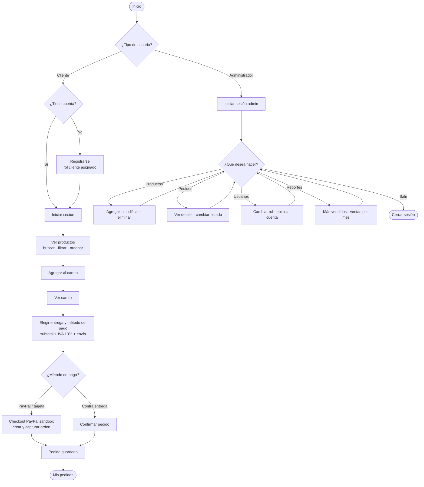

---

## Modelo de datos

La base de datos `CarnesDelSurDb` tiene **11 tablas**: 3 de negocio, 7 de ASP.NET Core Identity y el historial de migraciones de EF Core.

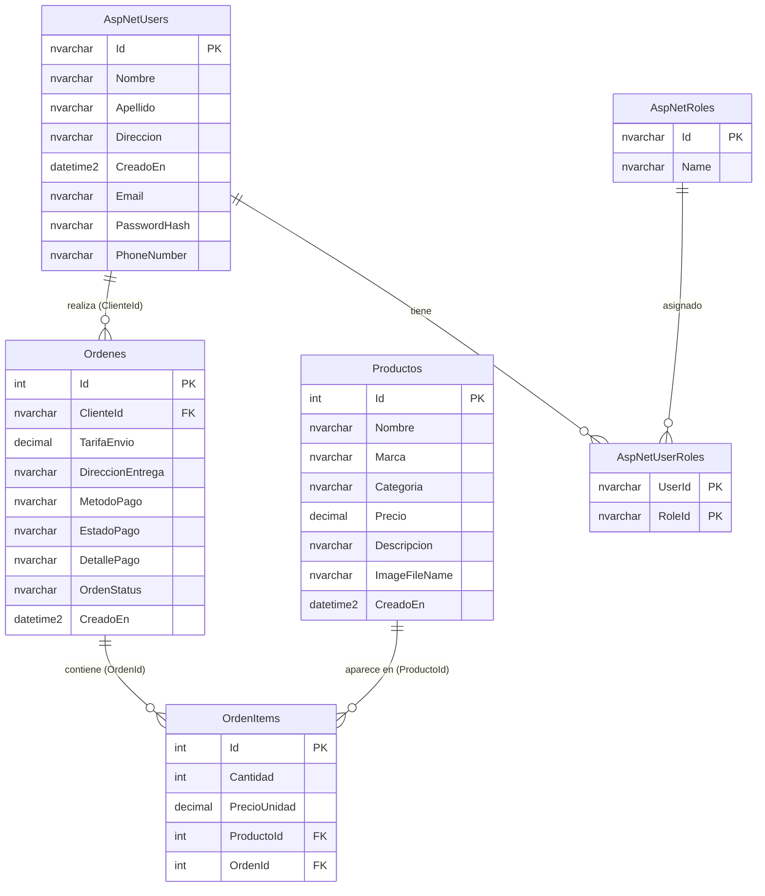

### Diccionario de datos (tablas de negocio)

**Productos**

| Columna | Tipo | Nulo | Notas |
|---|---|---|---|
| `Id` | `int` | No | PK, autonumérico |
| `Nombre` | `nvarchar(100)` | No | |
| `Marca` | `nvarchar(100)` | No | Filtro de la tienda |
| `Categoria` | `nvarchar(100)` | No | Filtro de la tienda |
| `Precio` | `decimal(16,2)` | No | En colones (₡) |
| `Descripcion` | `nvarchar(max)` | No | |
| `ImageFileName` | `nvarchar(100)` | No | Archivo en `wwwroot/productos/` |
| `CreadoEn` | `datetime2` | No | |

**Ordenes**

| Columna | Tipo | Nulo | Notas |
|---|---|---|---|
| `Id` | `int` | No | PK, autonumérico |
| `ClienteId` | `nvarchar(450)` | No | FK → `AspNetUsers.Id` |
| `TarifaEnvio` | `decimal(16,2)` | No | 0 si es retiro en el local |
| `DireccionEntrega` | `nvarchar(max)` | No | |
| `MetodoPago` | `nvarchar(max)` | No | `efectivo`, `paypal`, `credit_card` |
| `EstadoPago` | `nvarchar(max)` | No | p. ej. `pendiente`, `aceptado` |
| `DetallePago` | `nvarchar(max)` | No | Respuesta JSON de PayPal |
| `OrdenStatus` | `nvarchar(max)` | No | p. ej. `creada`, `pendiente` |
| `CreadoEn` | `datetime2` | No | |

**OrdenItems**

| Columna | Tipo | Nulo | Notas |
|---|---|---|---|
| `Id` | `int` | No | PK, autonumérico |
| `Cantidad` | `int` | No | |
| `PrecioUnidad` | `decimal(16,2)` | No | Precio al momento de la compra |
| `ProductoId` | `int` | No | FK → `Productos.Id` |
| `OrdenId` | `int` | Sí | FK → `Ordenes.Id` |

**AspNetUsers (columnas propias agregadas a Identity)**

| Columna | Tipo | Nulo |
|---|---|---|
| `Nombre` | `nvarchar(max)` | No |
| `Apellido` | `nvarchar(max)` | No |
| `Direccion` | `nvarchar(max)` | No |
| `CreadoEn` | `datetime2` | No |

El diccionario completo de las 11 tablas está en la documentación del proyecto.

---

## Cómo ejecutarlo en local

### Requisitos previos
- [.NET 7 SDK](https://dotnet.microsoft.com/download/dotnet/7.0)
- SQL Server o **SQL Server LocalDB** (se instala con Visual Studio)
- Visual Studio 2022 (recomendado) o la CLI de .NET
- *(Opcional)* Una cuenta de **PayPal Developer** para el sandbox y una de **Brevo** para el envío de correos

### 1. Clonar el repositorio
```bash
git clone https://github.com/Fiken014/Proyecto-Programado-Carnes-del-Sur.git
cd Proyecto-Programado-Carnes-del-Sur
```

### 2. Configurar los secretos con User Secrets
Las credenciales **no se guardan en el repositorio**: `appsettings.json` solo tiene campos vacíos. En Visual Studio, hacé clic derecho en el proyecto → **Manage User Secrets** y pegá esto:

```json
{
  "ConnectionStrings": {
    "DefaultConnection": "Server=(localdb)\\mssqllocaldb;Database=CarnesDelSurDb;Trusted_Connection=True;TrustServerCertificate=True"
  },
  "AdminSettings": {
    "Email": "admin@admin.com",
    "InitialPassword": "<tu-contraseña-inicial>"
  },
  "PayPalSettings": {
    "ClientId": "<client-id-sandbox>",
    "Secret": "<secret-sandbox>"
  },
  "BrevoSettings": {
    "ApiKey": "<api-key-brevo>",
    "SenderEmail": "<remitente-verificado-en-brevo>"
  }
}
```

Si preferís la terminal:
```bash
dotnet user-secrets init
dotnet user-secrets set "ConnectionStrings:DefaultConnection" "Server=(localdb)\\mssqllocaldb;Database=CarnesDelSurDb;Trusted_Connection=True;TrustServerCertificate=True"
dotnet user-secrets set "AdminSettings:InitialPassword" "<tu-contraseña-inicial>"
```

### 3. Crear la base de datos
```bash
dotnet tool install --global dotnet-ef   # solo la primera vez
dotnet ef database update
```
En Visual Studio también podés usar la **Package Manager Console** con `Update-Database`.

### 4. Ejecutar
```bash
dotnet run
```
La aplicación abre en `https://localhost:7265`. En el primer arranque, `DatabaseInitializer` crea los roles `admin` y `cliente` y un usuario administrador con las credenciales de `AdminSettings`. **Cambiá esa contraseña después del primer inicio de sesión.**

> El **catálogo empieza vacío**: iniciá sesión como administrador y cargá productos desde **Productos**.

---

## Seguridad aplicada

- Contraseñas gestionadas por **ASP.NET Core Identity**, que guarda hashes y nunca texto plano.
- **Autorización por roles** (`[Authorize(Roles = "admin")]` y `[Authorize(Roles = "cliente")]`) en todas las rutas de administración y de cliente.
- **Aislamiento de datos**: las consultas de pedidos del cliente filtran por el usuario autenticado.
- **Precios calculados en el servidor**: el carrito guarda solo IDs y cantidades, y los precios siempre se leen de la base de datos.
- **Validación de DTO** con `ModelState` en el servidor.
- **Secretos fuera del código fuente**, mediante User Secrets.
- Mensajes genéricos en el inicio de sesión y en la recuperación de contraseña, para no revelar si una cuenta existe.

---

## Limitaciones conocidas y próximos pasos

Este es un prototipo académico. Una revisión del código identificó las siguientes mejoras pendientes.

**Seguridad y correctitud**
- [ ] **Acciones que modifican datos por GET**: eliminar productos o cuentas, cambiar roles o estados y cerrar sesión. Hay que migrarlas a `POST` con `[ValidateAntiForgeryToken]`.
- [ ] **Validar cantidades del carrito** en el servidor (positivas y con un máximo razonable), ya que vienen de una cookie que el usuario puede editar.
- [ ] **Verificar la captura de PayPal**: comparar el monto y la moneda con el total calculado en el servidor y asociar la orden de PayPal al usuario. Unificar las claves del JSON entre la vista y `CompleteOrder`.
- [ ] **Conversión de moneda**: reemplazar el tipo de cambio fijo (÷ 500) por un valor configurable.
- [ ] **Carga de imágenes**: validar el tipo y el tamaño del archivo.
- [ ] **Reportes**: contar solo pedidos con pago aceptado y ordenar las ventas mensuales cronológicamente.
- [ ] **Estados de pedido**: usar un `enum` o una lista cerrada en lugar de texto libre.
- [ ] **Manejo de errores** en `EmailSender`, para que la vista sepa si el envío falló.

**Arquitectura y calidad**
- [ ] Separar el acceso a datos en **repositorios y servicios**, como propone el diagrama de componentes.
- [ ] **Pruebas automatizadas** (xUnit) para el carrito, los pedidos y los roles.
- [ ] Migrar a **.NET 8 LTS**, ya que .NET 7 dejó de recibir soporte.
- [ ] Despliegue público con una cuenta de demostración.

**Funciones diseñadas que todavía no están implementadas**
- [ ] **Inventario**: existencias y movimientos de stock.
- [ ] Gestión de **proveedores** y compras.
- [ ] **Cupones de descuento** y **suscripción a novedades** (incluidos en los mockups).
- [ ] **Notificaciones** al administrador.
- [ ] Comprobantes en **PDF**.
- [ ] Página de contacto con datos reales.

---

## 📄 Documentación del proyecto

El proyecto se diseñó antes de programarse. El archivo **`Documentation Carnes del Sur.zip`** contiene:

| Artefacto | Contenido |
|---|---|
| Especificación de requisitos | 35 requisitos (30 funcionales y 5 no funcionales) |
| Casos de uso | 14 fichas |
| Mockups | 8 pantallas (ver galería abajo) |
| Diagramas | Clases, componentes, flujo y base de datos |
| Diccionario de datos | 11 tablas, con tipos, nulos, claves y relaciones |

### Mockups (diseño inicial)

Los mockups representan la propuesta de interfaz. La aplicación final cambió algunos elementos (por ejemplo, la tienda tiene filtros por marca y categoría y el panel de administración usa una barra de navegación en lugar de un menú lateral).

| Inicio | Tienda | Carrito | Contacto |
|---|---|---|---|
| 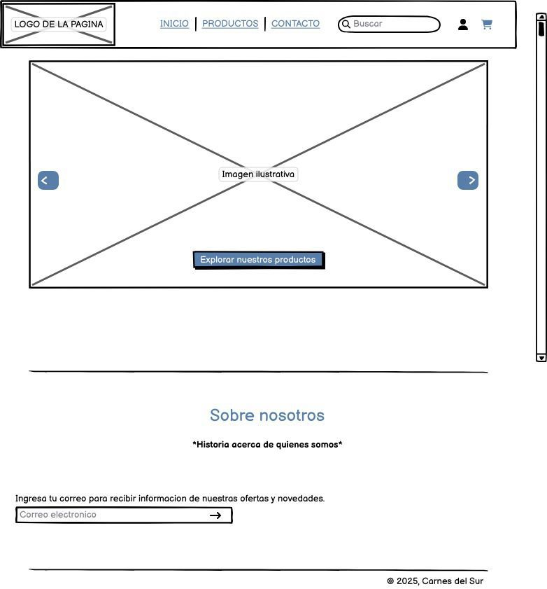 |  |  | 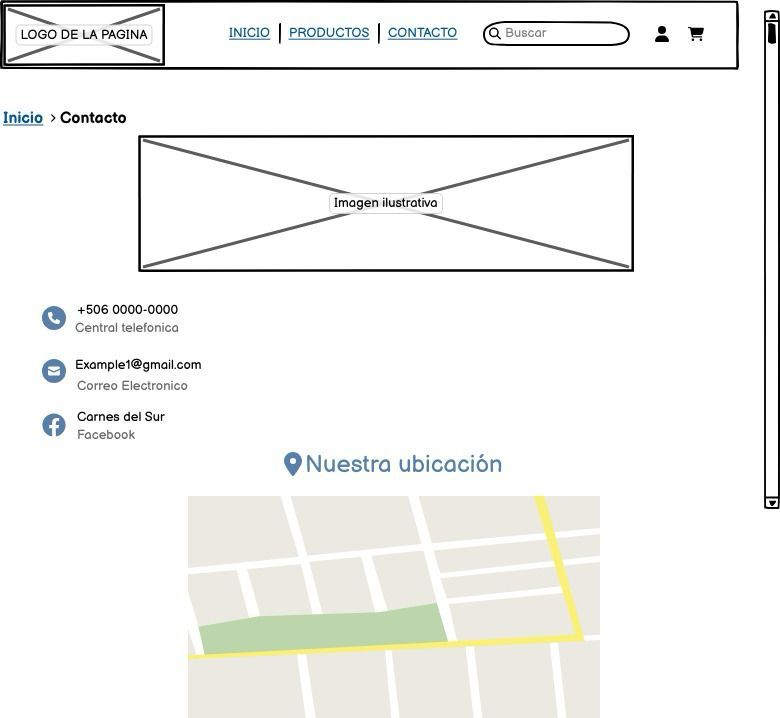 |

| Inicio de sesión | Registro | Perfil | Administración |
|---|---|---|---|
| 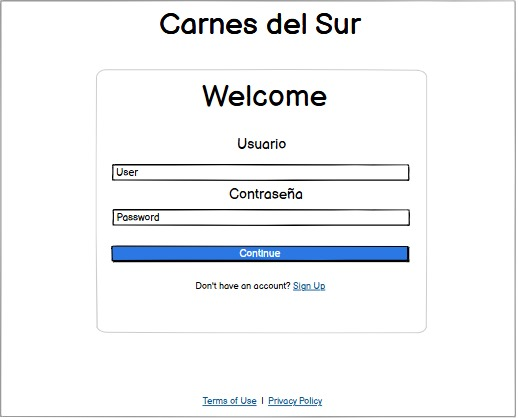 | 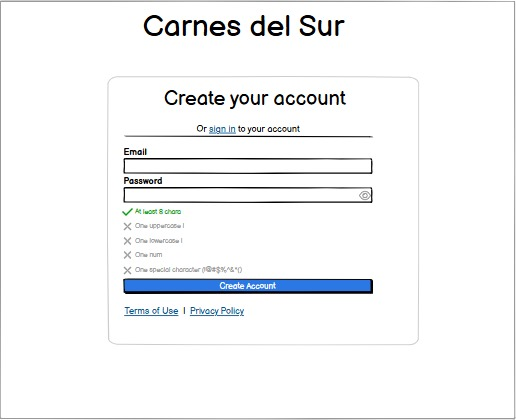 | 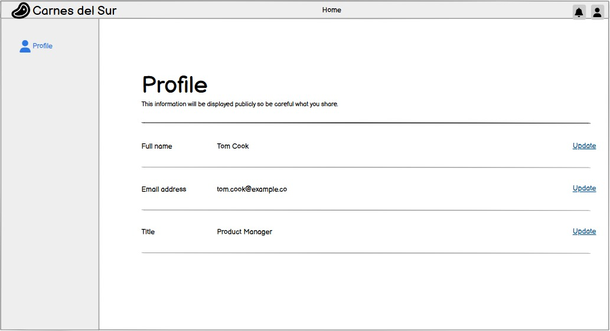 |  |

---

## Autoría

Proyecto del curso Metodología de Desarrollo de Software I, Universidad Americana, 2025. Equipo de cuatro integrantes (Grupo 3):

**Kendall Bonilla Miranda** — Coordinación y desarrollador del proyecto
[LinkedIn](https://www.linkedin.com/in/kendall-bonilla-miranda) · [GitHub](https://github.com/Fiken014)
